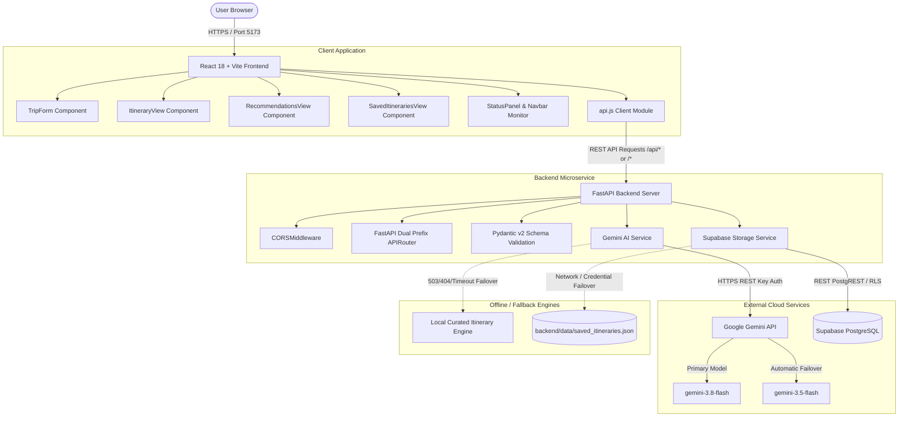

# WanderAI — Personalized Travel Itinerary Planner 🌍✨

A modern, full-stack, AI-powered travel itinerary planner built with **React 18 + Vite**, **Python FastAPI**, **Google Gemini AI**, and **Supabase (PostgreSQL)**.

Built for the **Capstone Project**.

- **GitHub Repository**: [https://github.com/aimjeestudy-dot/WanderAI](https://github.com/aimjeestudy-dot/WanderAI)
- **Live Frontend (Vercel)**: [https://wander-ai-eight.vercel.app](https://wander-ai-eight.vercel.app)
- **Backend API (Render)**: [https://wanderai-backend-ssup.onrender.com](https://wanderai-backend-ssup.onrender.com)
- **Local API Base**: `http://127.0.0.1:8000` | Swagger Docs: `http://127.0.0.1:8000/docs`

---

## 📑 Table of Contents
1. [Project Overview](#-project-overview)
2. [Problem Statement & Objectives](#-problem-statement--objectives)
3. [Features](#-features)
4. [Technology Stack](#-technology-stack)
5. [System Architecture](#-system-architecture)
6. [API Endpoints Table](#-api-endpoints-table)
7. [Prerequisites](#-prerequisites)
8. [Local Installation & Setup](#-local-installation--setup)
   - [1. Backend Setup](#1-backend-setup)
   - [2. Frontend Setup](#2-frontend-setup)
9. [Environment Variables](#-environment-variables)
10. [Google Gemini Integration](#-google-gemini-integration)
11. [Supabase Setup Instructions](#-supabase-setup-instructions)
12. [Running the Application](#-running-the-application)
13. [Running Tests](#-running-tests)
14. [Project Structure](#-project-structure)
15. [Deployment Guide (Vercel & Render)](#-deployment-guide)
16. [Known Limitations](#-known-limitations)
17. [Submission Documentation Index](#-submission-documentation-index)

---

## 🧭 Project Overview

**WanderAI** solves the overwhelm of trip planning by automatically generating personalized, realistic day-by-day itineraries tailored to each traveler's unique pace, interests, budget, and travel party.

The application utilizes **Google Gemini** for structured JSON generation, features a **responsive, accessible frontend** with a custom dark nebula aesthetic, stores trips in **Supabase PostgreSQL** protected with **Row Level Security (RLS)**, and includes an **offline local fallback** engine so the application functions seamlessly even during network outages, Render cold starts, or model availability spikes.

---

## 🎯 Problem Statement & Objectives

### Problem Statement
Travelers spend an average of 10 to 20 hours reading fragmented blogs and commercial tour pages to plan a trip. Raw conversational AI chatbots output unstructured walls of text that lack chronological realism, cost estimates, or day-by-day grouping. Furthermore, direct client-side AI integration risks leaking API keys and crashes on timeout.

### Objectives
- Provide an intuitive form capturing 9 travel parameters (destination, duration, budget, style, party size, pace, interests, dietary needs, notes).
- Implement a backend proxy using FastAPI to secure all credentials and validate data strictly using Pydantic.
- Leverage Google Gemini with structured prompt engineering to return validated JSON matching a nested daily schema.
- Implement fault-tolerant model failover (`gemini-3.8-flash` -> `gemini-3.5-flash` -> local demo template).
- Provide cloud persistence in Supabase PostgreSQL with local JSON file fallback.

---

## 🌟 Features

- **Personalized Itinerary Generator**: Customizes plans by destination, duration (1–14 days), budget tier (Budget, Moderate, Luxury), travel style (Solo, Couple, Family, Friends), traveler count, and specific interests.
- **Structured Day-by-Day Schedules**: Generates curated morning, afternoon, and evening activities with realistic transit, cost estimates, and local insider tips.
- **Smart Destination Discovery**: Interactive recommendations engine matching travelers to ideal destinations based on vibe, season, and budget.
- **Cloud Persistence with Supabase**: Save, search, manage, and delete itineraries backed by PostgreSQL.
- **Personal Notes & Editing**: Add custom flight details, hotel confirmations, and personal notes directly to saved itineraries with automatic upserting.
- **Resilient AI Fallback & Model Failover**: Automatic retry on `gemini-3.5-flash` when the primary model experiences high-demand spikes (HTTP 503), plus an algorithmic local generator clearly labelled as demo mode.
- **Interactive Checklists & Tips**: Dynamic packing checklist with checkboxes, local culinary recommendations, and safety advisories.
- **Export & Share**: Instant one-click copy formatted Markdown to share via email, messaging, or notes apps.
- **Zero-Secret Frontend**: All API keys and database calls are proxied securely through FastAPI; credentials are never exposed to the client.

---

## 🛠 Technology Stack

| Component | Technology | Description |
|---|---|---|
| **Frontend** | React 18, Vite | Component-driven Single Page Application (SPA) |
| **Styling** | Vanilla CSS Design System | Curated dark nebula theme, glassmorphism, responsive CSS grid/flex |
| **Icons** | Lucide React | Lightweight, consistent iconography |
| **Backend** | Python 3.10+, FastAPI, Uvicorn | High-performance asynchronous REST API |
| **Data Validation** | Pydantic v2 | Strict schema validation for incoming requests and responses |
| **AI Engine** | Google Gemini API (`gemini-3.8-flash`, `gemini-3.5-flash`) | Structured prompting returning validated JSON |
| **Database** | Supabase (PostgreSQL) | Managed cloud database with Row Level Security (RLS) |
| **Local Fallback** | JSON File Persistence | Automatic local storage fallback (`backend/data/saved_itineraries.json`) |
| **Testing** | Pytest, TestClient, Pytest-Asyncio | Automated backend validation and integration test suite |
| **Deployment** | Vercel (Frontend), Render (Backend) | Cloud CI/CD and hosting |

---

## 🏗 System Architecture



---

## 🔌 API Endpoints Table

The backend mounts all routes under **both `/api` and root `""`**, ensuring zero 404 routing errors whether clients prepend `/api` or not:

| HTTP Method | Endpoint (`/api` or root) | Request Body Schema | Response Schema | Description |
|---|---|---|---|---|
| `GET` | `/` | None | `{ "app": str, "status": str }` | Root health check and API version info |
| `GET` | `/api/status` or `/status` | None | `SystemStatus` | Live connectivity status for Gemini and Supabase |
| `POST` | `/api/recommendations` or `/recommendations` | `RecommendationRequest` | `RecommendationResponse` | Curates 4 tailored destination cards |
| `POST` | `/api/itineraries/generate` or `/itineraries/generate` | `ItineraryGenerateRequest` | `Itinerary` | Generates complete day-by-day itinerary via Gemini |
| `POST` | `/api/itineraries` or `/itineraries` | `SaveItineraryRequest` | `{ "status": str, "record": dict }` | Saves itinerary to Supabase (or local fallback) |
| `GET` | `/api/itineraries` or `/itineraries` | None | `{ "count": int, "itineraries": [] }` | Retrieves all saved travel itineraries |
| `GET` | `/api/itineraries/{id}` or `/itineraries/{id}` | None | `ItineraryRecord` | Retrieves single itinerary by UUID |
| `DELETE` | `/api/itineraries/{id}` or `/itineraries/{id}` | None | `{ "status": str, "message": str }` | Deletes an itinerary by UUID |
| `PATCH` | `/api/itineraries/{id}/notes` or `/itineraries/{id}/notes` | `{ "notes": str }` | `{ "status": str, "record": dict }` | Updates personal notes on a saved itinerary |

---

## 📋 Prerequisites

Ensure you have the following installed on your machine:
- **Node.js**: v18.0.0 or higher ([Download Node.js](https://nodejs.org/))
- **npm**: v9.0.0 or higher (packaged with Node.js)
- **Python**: v3.10, v3.11, v3.12, v3.13, or v3.14 ([Download Python](https://www.python.org/))
- **Git**: ([Download Git](https://git-scm.com/))

---

## 🚀 Local Installation & Setup

Clone the repository:
```bash
git clone https://github.com/aimjeestudy-dot/WanderAI.git
cd WanderAI
```

### 1. Backend Setup

1. Navigate to the `backend` directory:
   ```bash
   cd backend
   ```

2. Create and activate a Python virtual environment:
   - **macOS/Linux**:
     ```bash
     python3 -m venv .venv
     source .venv/bin/activate
     ```
   - **Windows**:
     ```bash
     python -m venv .venv
     .venv\Scripts\activate
     ```

3. Install required Python packages:
   ```bash
   pip install -r requirements.txt
   ```

4. Create your local environment file:
   ```bash
   cp .env.example .env
   ```
   *(Edit `backend/.env` with your API credentials as described in the next section).*

### 2. Frontend Setup

1. In a separate terminal, navigate to the `frontend` directory:
   ```bash
   cd frontend
   ```

2. Install dependencies:
   ```bash
   npm install
   ```

---

## 🔑 Environment Variables

All secrets are managed inside **`backend/.env`**.

> **Security Rule**: Never commit `backend/.env` or any real API keys to version control. The file is listed in `.gitignore`.

Example `backend/.env` configuration:

```env
# ============================================================
# Google Gemini AI Configuration
# Obtain a free API key at: https://aistudio.google.com/
# ============================================================
GEMINI_API_KEY=your_gemini_api_key_here
GEMINI_MODEL=gemini-3.8-flash
GEMINI_TIMEOUT_SECONDS=30

# ============================================================
# Supabase Database Configuration
# Obtain from Supabase Dashboard -> Project Settings -> API
# ============================================================
SUPABASE_URL=https://your-project-id.supabase.co
SUPABASE_ANON_KEY=your_supabase_anon_key_here

# Leave empty for standard use (respects Row Level Security)
SUPABASE_SERVICE_ROLE_KEY=
```

Frontend environment variables (optional, in `frontend/.env`):
```env
# In development, leave blank to use the Vite proxy (/api)
# In production on Vercel, set to your Render backend URL:
VITE_API_BASE_URL=https://your-backend.onrender.com
```

---

## 🤖 Google Gemini Integration

1. Go to [Google AI Studio](https://aistudio.google.com/) and create a free API key.
2. Put the key into `backend/.env`: `GEMINI_API_KEY=your_key`.
3. The backend communicates with Gemini via asynchronous `httpx` POST calls to `v1beta/models/{model}:generateContent`.
4. It sets `"responseMimeType": "application/json"` to ensure strict JSON output.
5. If the primary model `gemini-3.8-flash` experiences an HTTP 503 spike, it retries automatically with `gemini-3.5-flash`.
6. If no key is set or all calls fail, the local generator provides a complete demo plan with `is_demo_mode = True`.

---

## 🗄 Supabase Setup Instructions

1. Go to [Supabase.com](https://supabase.com/) and create a free project.
2. In the Supabase dashboard, open the **SQL Editor**.
3. Open [`backend/supabase_schema.sql`](backend/supabase_schema.sql), copy the SQL, paste it into the editor, and click **Run**.
4. Go to **Project Settings → API** and copy:
   - **Project URL** -> `SUPABASE_URL` in `backend/.env`
   - **anon public key** -> `SUPABASE_ANON_KEY` in `backend/.env`
5. Restart the backend. The Status pill in the navigation will show green for Supabase.

---

## 💻 Running the Application

### 1. Start the FastAPI Backend
```bash
cd backend
source .venv/bin/activate
uvicorn app.main:app --reload --host 127.0.0.1 --port 8000
```
- API Base: `http://127.0.0.1:8000`
- Swagger UI Docs: `http://127.0.0.1:8000/docs`
- Status Endpoint: `http://127.0.0.1:8000/api/status`

### 2. Start the Vite Frontend
```bash
cd frontend
npm run dev
```
- Open browser at: **`http://localhost:5173`**

---

## 🧪 Running Tests

### Backend Automated Tests (Pytest)
Run the full test suite verifying endpoints, validation, dual-prefix routing, and CRUD flow:

```bash
cd backend
.venv/bin/pytest -v
```

Expected output:
```
backend/tests/test_api.py::test_root_endpoint PASSED                     [ 12%]
backend/tests/test_api.py::test_system_status PASSED                     [ 25%]
backend/tests/test_api.py::test_system_status_without_prefix PASSED      [ 37%]
backend/tests/test_api.py::test_generate_itinerary_validation_error PASSED [ 50%]
backend/tests/test_api.py::test_generate_itinerary_success PASSED        [ 62%]
backend/tests/test_api.py::test_gemini_timeout_uses_demo_itinerary PASSED [ 75%]
backend/tests/test_api.py::test_recommendations_endpoint PASSED          [ 87%]
backend/tests/test_api.py::test_itinerary_crud_flow PASSED               [100%]

========================= 8 passed, 1 warning in 9.04s =========================
```

### Frontend Production Build
```bash
cd frontend
npm run build
```
Builds `dist/` cleanly in under 400ms with zero errors.

---

## 📂 Project Structure

```
wanderai-travel-planner/
├── .gitignore                      # Excludes .env, node_modules, caches, virtualenvs
├── README.md                       # Main documentation & setup guide
├── render.yaml                     # Render.com Infrastructure Blueprint
│
├── docs/                           # Submission & Academic Materials
│   ├── PROJECT_REPORT.md           # Formal academic report
│   ├── VIVA_PREPARATION.md         # Viva voce Q&A guide (25 questions)
│   └── SUBMISSION_CHECKLIST.md     # Final submission checklist
│
├── backend/
│   ├── .env.example                # Safe environment variables template
│   ├── .env                        # Local credentials (ignored by Git)
│   ├── requirements.txt            # Python dependencies
│   ├── supabase_schema.sql         # Idempotent PostgreSQL DDL, RLS & indexes
│   ├── app/
│   │   ├── __init__.py
│   │   ├── config.py               # Settings loader with dynamic environment reloading
│   │   ├── main.py                 # FastAPI application & dual-prefix APIRouter
│   │   ├── models/
│   │   │   ├── __init__.py
│   │   │   └── schemas.py          # Pydantic schemas (validation & data transfer objects)
│   │   └── services/
│   │       ├── __init__.py
│   │       ├── gemini_service.py   # Gemini prompt builder, API client & model failover
│   │       └── supabase_service.py # Supabase client with local JSON fallback
│   ├── data/
│   │   ├── .gitkeep
│   │   └── saved_itineraries.json  # Local storage fallback
│   └── tests/
│       ├── __init__.py
│       └── test_api.py             # Pytest integration & endpoint validation tests
│
└── frontend/
    ├── index.html                  # HTML entry point with Google Fonts preconnections
    ├── package.json                # React 18, Vite & dependencies
    ├── vite.config.js              # Vite server configuration & /api reverse proxy
    ├── vercel.json                 # SPA rewrite configuration for Vercel deployment
    └── src/
        ├── main.jsx                # React root mount
        ├── App.jsx                 # Main application state & notification controller
        ├── index.css               # Vanilla CSS design system (tokens, glassmorphism)
        ├── services/
        │   └── api.js              # Frontend API client with request timeout wrapper
        └── components/
            ├── Navbar.jsx          # Header navigation, brand & live status indicator
            ├── TripForm.jsx        # Travel preference inputs with quick-select chips
            ├── ItineraryView.jsx   # Interactive day tabs, activities, notes & checklist
            ├── RecommendationsView.jsx # Discovery cards with match percentages & 1-click plan
            ├── SavedItinerariesView.jsx# Saved trip cards, search filter & note updates
            └── StatusPanel.jsx     # Diagnostics & configuration instructions
```

---

## 🚢 Deployment Guide

### Frontend Deployment (Vercel)
1. Push your repository to GitHub.
2. Sign in to [Vercel](https://vercel.com/) and click **Add New Project**.
3. Select your repository and set **Root Directory** to `frontend`.
4. In Environment Variables, set:
   ```env
   VITE_API_BASE_URL=https://your-backend.onrender.com
   ```
5. Click **Deploy**. Vercel uses `frontend/vercel.json` to handle SPA routing.

### Backend Deployment (Render)
1. Sign in to [Render](https://render.com/).
2. Click **New +** → **Blueprint** and select your repository (reads `render.yaml`).
   - Or create a **Web Service**:
     - **Root Directory**: `backend`
     - **Environment**: Python
     - **Build Command**: `pip install -r requirements.txt`
     - **Start Command**: `uvicorn app.main:app --host 0.0.0.0 --port $PORT`
3. Under **Environment Variables**, add:
   - `GEMINI_API_KEY`: Your Google AI Studio API key
   - `GEMINI_MODEL`: `gemini-3.8-flash`
   - `GEMINI_TIMEOUT_SECONDS`: `30`
   - `SUPABASE_URL`: Your Supabase URL
   - `SUPABASE_ANON_KEY`: Your Supabase anon public key
4. Click **Create Web Service**.

---

## ⚠️ Known Limitations

1. **Render Free Tier Cold Starts**: On Render's free tier, inactive services sleep after 15 minutes. The first request takes 50–90 seconds to boot the container. The client timeout is configured to 90 seconds.
2. **Third-Party AI Demand**: Google Gemini free tier can experience momentary 503 high-demand spikes. Our service automatically retries with `gemini-3.5-flash` and falls back to deterministic local templates.
3. **No Real-Time Transit APIs**: Estimated activity costs and schedules are generated via AI and reference heuristics rather than live integrations with Uber or airlines.

---

## 📚 Submission Documentation Index

- [docs/PROJECT_REPORT.md](docs/PROJECT_REPORT.md) — Comprehensive academic report.
- [docs/VIVA_PREPARATION.md](docs/VIVA_PREPARATION.md) — Viva examination defense guide (25 Q&As).
- [docs/SUBMISSION_CHECKLIST.md](docs/SUBMISSION_CHECKLIST.md) — Final college submission checklist.
