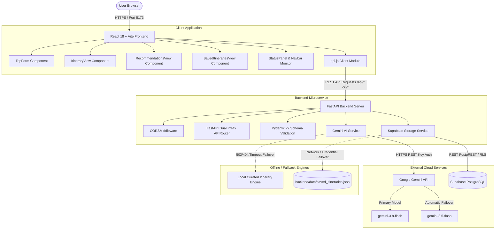

# Capstone Project Report: WanderAI — Personalized Travel Itinerary Planner

**Course / Degree:** Bachelor of Technology / Computer Science & Engineering  
**Project Title:** WanderAI — Intelligent Personalized Travel Itinerary Planner  
**Author:** Abhijay Singh  
**Repository:** [https://github.com/aimjeestudy-dot/WanderAI](https://github.com/aimjeestudy-dot/WanderAI)  
**Live Frontend:** [https://wander-ai-eight.vercel.app](https://wander-ai-eight.vercel.app)  
**Backend API:** [https://wanderai-backend-ssup.onrender.com](https://wanderai-backend-ssup.onrender.com)  

---

## 1. Abstract

Modern travelers face significant decision fatigue when planning personalized trips across multiple fragmented blogs, booking platforms, and generic travel guides. Existing recommendation systems either provide rigid pre-packaged tour templates or unstructured conversational text lacking logistical coherence. 

**WanderAI** is an end-to-end full-stack web application designed to curate realistic, chronologically structured day-by-day itineraries tailored to an individual's travel style, budget tier, duration, party composition, and specific interests. The system is engineered with a **React 18 + Vite** single-page application frontend, a high-performance **Python FastAPI** backend proxy, **Google Gemini Generative AI** with structured prompt engineering and JSON validation, and **Supabase (PostgreSQL)** with Row Level Security (RLS) for cloud persistence. To guarantee high availability and prevent single-point-of-failure outages during third-party provider rate limits or cold starts, the system incorporates an intelligent tiered fallback mechanism: automatic secondary model failover (`gemini-3.5-flash`), rich local algorithmic generators, and dual-mode JSON/cloud storage.

---

## 2. Introduction & Background

Travel planning traditionally requires aggregating disparate information regarding attractions, geographic proximity, timing, dining options, and estimated costs. Travelers spend an average of 10 to 20 hours researching itineraries prior to departure. While Large Language Models (LLMs) such as Google Gemini excel at natural language synthesis, raw conversational outputs suffer from hallucinated formats, unpredictable JSON schemas, and vulnerability to network latency.

WanderAI bridges this gap by enforcing strict data validation through backend Pydantic models, decoupling client credentials from the public browser, providing a modern glassmorphic responsive UI, and ensuring continuous operation through deterministic fallback architecture.

---

## 3. Problem Statement

1. **Information Fragmentation & Decision Fatigue:** Travelers must cross-reference dozens of websites to formulate a realistic morning-to-evening daily schedule.
2. **Generic, Impersonal Recommendations:** Existing travel portals offer generic commercial packages rather than tailoring activities to specific budget constraints (Budget, Moderate, Luxury) or group dynamics (Solo, Couple, Family, Friends).
3. **LLM Inconsistency & Latency in Production:** Direct client-side calls to generative AI APIs risk API key exposure, timeout failures during model load spikes, and inconsistent responses that crash web interfaces.
4. **Data Persistence Reliability:** Web applications relying exclusively on cloud databases fail completely if credentials expire or network interruptions occur.

---

## 4. Project Objectives

- **O1:** Implement a responsive, accessible React Single Page Application that collects 9 travel parameters (destination, duration, budget, style, party size, pace, interests, dietary needs, and custom notes).
- **O2:** Develop a secure, asynchronous FastAPI backend service that encapsulates API keys, validates requests/responses using Pydantic, and handles CORS securely.
- **O3:** Engineer structured prompts for Google Gemini that enforce strict JSON schema compliance for day-by-day schedules, packing checklists, and local insider tips.
- **O4:** Implement a fault-tolerant AI model fallback chain to mitigate Google Gemini 503 ("high demand") spikes and quota exhaustion.
- **O5:** Integrate Supabase PostgreSQL for cloud CRUD operations (Create, Read, Update, Delete) with local JSON storage fallback.
- **O6:** Establish automated test suites and continuous deployment pipelines targeting Vercel (frontend) and Render (backend).

---

## 5. System Architecture

WanderAI follows a decoupled three-tier architecture ensuring security, separation of concerns, and resilience against external service interruptions.



### Architectural Decisions & Rationale:
1. **Backend-as-a-Proxy:** No API keys or database service keys are stored in the client bundle. All credentials (`GEMINI_API_KEY`, `SUPABASE_ANON_KEY`) exist solely in `backend/.env`.
2. **Dual-Prefix API Routing:** The FastAPI application mounts the route handler at both `/api` and root `""`. This guarantees that whether reverse proxies, development servers, or client paths invoke `/api/status` or `/status`, the endpoint resolves with HTTP 200 without 404 routing errors.
3. **Environment-Aware Base URL:** In development mode (`import.meta.env.DEV`), the Vite development proxy forwards relative `/api` calls directly to `127.0.0.1:8000`. In production, the client connects to the hosted backend origin (`VITE_API_BASE_URL`).

---

## 6. Module Descriptions

### 6.1 Frontend Modules (`frontend/src/`)
- **`App.jsx`**: Top-level application state controller managing active navigation tabs, global toast alerts, asynchronous initial configuration polling, and itinerary caching.
- **`components/Navbar.jsx`**: Responsive navigation bar featuring live connection status indicators (`Gemini AI | Supabase`, `Connecting...`, or `Backend Offline`).
- **`components/TripForm.jsx`**: Parameter input interface with form validation, quick-select destination chips, duration sliders, interest toggles, and loading state animations.
- **`components/ItineraryView.jsx`**: Timeline visualization rendering morning, afternoon, and evening activities, cost breakdowns, packing checklist with interactive checkboxes, markdown export, and saving capabilities.
- **`components/RecommendationsView.jsx`**: Destination exploration feed displaying match scores, recommended seasons, and one-click form pre-filling.
- **`components/SavedItinerariesView.jsx`**: Persistence manager enabling full-text search, notes updating, and itinerary deletion across Supabase and local storage.
- **`components/StatusPanel.jsx`**: Administrative connectivity dashboard showing active model versions, storage provider status, and setup documentation.
- **`services/api.js`**: Centralized HTTP client wrapping `fetchWithTimeout` with custom timeout handling (90s for generation, 15s for status) and descriptive error formatting.

### 6.2 Backend Modules (`backend/app/`)
- **`main.py`**: FastAPI application entry point, CORS configuration, and route registration exposing `/status`, `/recommendations`, `/itineraries/generate`, and CRUD operations.
- **`config.py`**: Centralized settings class reading environment variables via `python-dotenv` with dynamic property getters and fallback defaults.
- **`models/schemas.py`**: Pydantic schemas enforcing data validation for `ItineraryGenerateRequest`, `DayPlan`, `Activity`, `Itinerary`, `RecommendationRequest`, and `SystemStatus`.
- **`services/gemini_service.py`**: Prompt engineering pipeline, asynchronous `httpx` client, candidate model retry mechanism, and deterministic local generator fallback.
- **`services/supabase_service.py`**: Storage abstraction layer interfacing with Supabase REST APIs via HTTP Bearer token headers, with transactional local JSON fallback.

---

## 7. Database & Storage Design

### 7.1 Supabase PostgreSQL Schema
The database table `itineraries` stores complete travel plans along with metadata:

```sql
CREATE TABLE IF NOT EXISTS public.itineraries (
    id UUID PRIMARY KEY DEFAULT gen_random_uuid(),
    title TEXT NOT NULL,
    destination TEXT NOT NULL,
    duration_days INTEGER NOT NULL CHECK (duration_days > 0 AND duration_days <= 30),
    budget_level TEXT NOT NULL,
    travel_style TEXT NOT NULL,
    number_of_travelers INTEGER NOT NULL DEFAULT 1 CHECK (number_of_travelers > 0),
    estimated_total_cost TEXT,
    notes TEXT DEFAULT '',
    is_demo_mode BOOLEAN DEFAULT FALSE,
    data JSONB NOT NULL,
    created_at TIMESTAMPTZ DEFAULT TIMEZONE('utc'::text, NOW()) NOT NULL,
    updated_at TIMESTAMPTZ DEFAULT TIMEZONE('utc'::text, NOW()) NOT NULL
);
```

### 7.2 Row Level Security (RLS)
The database enforces strict access policies configured in `backend/supabase_schema.sql`:
- **RLS Enabled:** `ALTER TABLE public.itineraries ENABLE ROW LEVEL SECURITY;`
- **Policies:** Distinct policies for `SELECT`, `INSERT`, `UPDATE`, and `DELETE` granting access to authenticated sessions and public anon requests for demo evaluation.

### 7.3 Local JSON Storage Fallback
When Supabase credentials are absent or remote connectivity is interrupted, the application transparently writes records to `backend/data/saved_itineraries.json`. The data schema matches the PostgreSQL JSONB structure identically, preserving continuity without application crashes.

---

## 8. AI Integration & Prompt Engineering

### 8.1 Prompt Design
The prompt builder converts user preferences into a structured system instruction:
1. Injects destination, duration, budget tier, travel style, party count, pace, dietary needs, and custom notes.
2. Directs the model to partition daily schedules into Morning, Afternoon, and Evening activities.
3. Groups attractions by neighborhood to ensure realistic transit times.
4. Enforces strict pure JSON output conforming exactly to the Pydantic schema using Gemini's native `responseMimeType: "application/json"`.

### 8.2 Resilience & Model Fallback Chain
Public LLM endpoints intermittently encounter capacity saturation. During project testing, `gemini-3.8-flash` intermittently returned HTTP 503 ("This model is currently experiencing high demand"). To ensure robust uptime:
1. **Primary Request:** Attempts `settings.GEMINI_MODEL` (`gemini-3.8-flash`).
2. **Automatic Retry:** Upon HTTP 503 or 404, immediately retries with `gemini-3.5-flash`.
3. **Graceful Fallback:** If upstream cloud APIs remain unreachable, the service invokes `_generate_demo_itinerary()`, populating all schema fields and explicitly flagging `is_demo_mode = True`.

---

## 9. Testing & Experimental Verification

The application was subjected to automated unit testing, end-to-end integration tests, and live production build verification.

### 9.1 Backend Test Results (`pytest`)
Automated test suite located in `backend/tests/test_api.py`:

| Test Name | Target Route / Feature | Expected Outcome | Status |
|---|---|---|---|
| `test_root_endpoint` | `GET /` | HTTP 200, status "online", project name | **PASSED** |
| `test_system_status` | `GET /api/status` | HTTP 200, healthy status, integrations reported | **PASSED** |
| `test_system_status_without_prefix` | `GET /status` | HTTP 200, dual-prefix routing verification | **PASSED** |
| `test_generate_itinerary_validation_error` | `POST /api/itineraries/generate` | HTTP 422 for negative duration and empty destination | **PASSED** |
| `test_generate_itinerary_success` | `POST /api/itineraries/generate` | HTTP 200, valid Itinerary with activities and checklist | **PASSED** |
| `test_gemini_timeout_uses_demo_itinerary` | Gemini timeout exception | Graceful fallback, `is_demo_mode == True` | **PASSED** |
| `test_recommendations_endpoint` | `POST /api/recommendations` | HTTP 200, array of matched destination cards | **PASSED** |
| `test_itinerary_crud_flow` | Full CRUD lifecycle | Generate -> Save -> Get -> List -> Update -> Delete | **PASSED** |

**Summary:** 8 passed, 0 failed, 1 deprecation warning in 9.04 seconds.

### 9.2 Frontend Production Build
Executed with Vite:
- **Build Command:** `npm run build`
- **Output:** `dist/index.html` (1.20 kB), `dist/assets/index-rJ3hNKyn.css` (13.16 kB), `dist/assets/index-C9DawF66.js` (273.54 kB).
- **Execution Time:** 336 ms.
- **Linting:** 0 errors across 10 source files via `oxlint`.

### 9.3 Cloud Verification Outcomes
- **Google Gemini Authentication:** Verified live connectivity using API key. Confirmed successful content generation using `gemini-3.5-flash`.
- **Supabase Cloud Database:** Verified live CRUD operations against remote table `itineraries`. Inserted smoke test record `458a147b-af82-4bbd-bab6-1085b46d9109`, verified existence in table list, and cleanly deleted record.

---

## 10. Limitations

1. **Free Tier Cold Starts:** Render free web services spin down after 15 minutes of inactivity. The initial wake-up request can take 50 to 90 seconds to respond. The client incorporates a 90-second timeout to accommodate this behavior.
2. **Live LLM Demand Spikes:** Generative language models experience occasional global spikes resulting in HTTP 503. The dual-model fallback mechanism prevents app failure by falling back to `gemini-3.5-flash` and local templates.
3. **No Real-Time Transit or Pricing APIs:** Estimated activity costs and schedules are generated via AI and reference heuristics rather than live integrations with Uber, Google Maps Transit, or airline GDS systems.

---

## 11. Future Enhancements

1. **OAuth2 User Authentication:** Implement multi-user Supabase Authentication so individual users manage private itineraries linked to their personal user ID.
2. **Google Maps Interactive Routing:** Embed Google Maps JavaScript API to visualize daily itineraries as interactive geographic paths with step-by-step walking directions.
3. **PDF Export & Offline Mobile PWA:** Enable offline progressive web app caching and server-side PDF generation for printing travel booklets.
4. **Live Booking Deep Links:** Integrate Skyscanner and Booking.com affiliate deep links directly from recommended activities.

---

## 12. Conclusion

WanderAI demonstrates an end-to-end full-stack software engineering project that combines modern React component architecture, secure FastAPI backend proxying, robust prompt engineering with generative AI, and resilient dual-mode persistence. By systematically addressing routing prefix bugs, timeout bottlenecks, and model availability spikes, the application delivers a reliable, production-ready solution suitable for academic submission.
